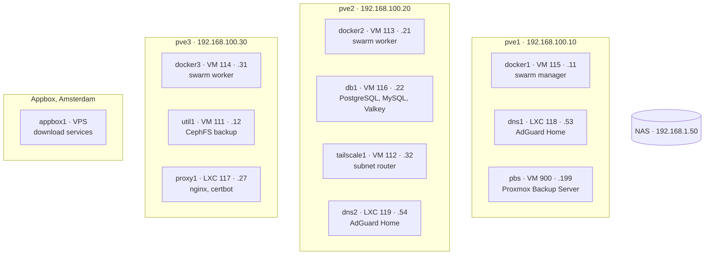
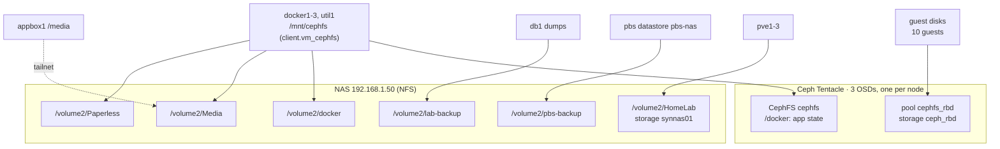
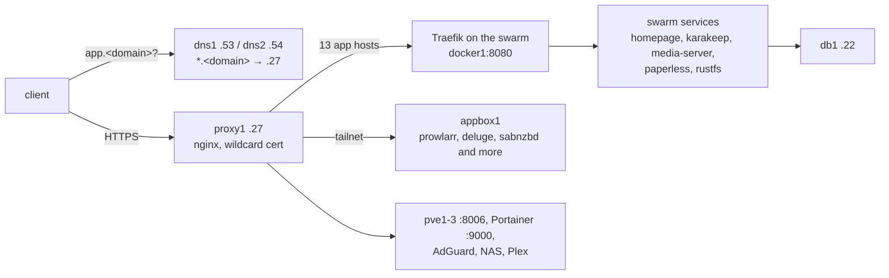
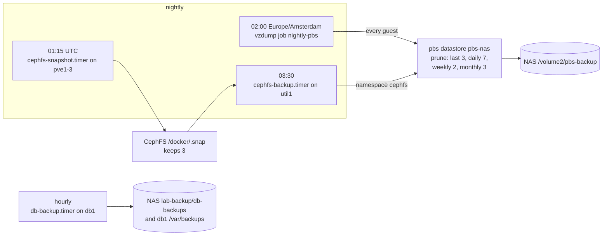

# Architecture

This file shows the layout on 2026-10-21. The data comes from the inventory
(`inventories/prod/`) and the live hosts. `<domain>` is the private domain
(`inventories/prod/group_vars/all/private.yml`).

## Hosts and guests

Three Proxmox VE 9 nodes make the cluster `homelab`. All guest disks are on Ceph RBD
(storage `ceph_rbd`). When a node fails, HA starts its guests on a different node.

| Host | Type | OS | Node | Address | Function |
| --- | --- | --- | --- | --- | --- |
| pve1-3 | hardware | PVE 9.2 (Debian 13) | - | .10, .20, .30 | hypervisor, Ceph mon, mgr, OSD and MDS |
| pbs | VM 900 | PBS 4.2 | pve1 | .199 | backups, datastore `pbs-nas` on the NAS |
| docker1 | VM 115 | Ubuntu 24.04 | pve1 | .11 | swarm manager, Portainer, Traefik |
| docker2, docker3 | VM 113, 114 | Ubuntu 24.04 | pve2, pve3 | .21, .31 | swarm workers |
| db1 | VM 116 | Ubuntu 24.04 | pve2 | .22 | PostgreSQL 17, MySQL 8.4, Valkey 8.0 |
| util1 | VM 111 | Ubuntu 24.04 | pve3 | .12 | CephFS backup to PBS, database client tools |
| tailscale1 | VM 112 | Ubuntu 24.04 | pve2 | .32 | Tailscale subnet router for 192.168.100.0/24 |
| dns1, dns2 | LXC 118, 119 | Debian 13 | pve1, pve2 | .53, .54 | AdGuard Home. The HA rule `dns-apart` keeps them on different nodes |
| proxy1 | LXC 117 | Debian 13 | pve3 | .27 | nginx reverse proxy for `*.<domain>` |
| appbox1 | VPS | Ubuntu 24.04 | Appbox | tailnet only | download services (`docs/appbox.md`) |

## Networks

There is one NAS. It is on the home network, and it is also a member of the tailnet.

- The LAN is `vmbr0` on `eno1`. Corosync (`ring0_addr`) and the Ceph mons
  (`public_network`) use the LAN.
- OSD replication uses the Ceph network on `enp2s0`, with its own switch (.5.10, .5.20,
  .5.30).
- The gateway routes between the LAN, the home network and the network KVMs
  (192.168.90.10, .20, .30, one for each node).
- tailscale1 advertises 192.168.100.0/24 to the tailnet. docker1-3 and proxy1 send
  100.64.0.0/10 through tailscale1. Thus the arr apps and proxy1 reach appbox1.
- appbox1 mounts the NAS share `Media` over the tailnet.
- The controller reaches the LAN through the tailscale1 subnet route. When Tailscale is
  down, it uses the gateway.
- The network KVMs do not need the lab DNS or the subnet route.

## Storage

- Swarm stacks keep their state on CephFS in `/mnt/cephfs/docker/<app>`. Media and
  documents are on the NAS.
- Kernel CephFS clients use `ceph-common` 20.2 from `download.ceph.com` and the HWE kernel
  7.0. The reason is that all Ceph keys are `aes256k`.

## Request path

- Each `*.<domain>` name resolves to proxy1. Exact rewrites for hosts (`db1`, `dns1`,
  `docker1` and more) are the exceptions. `group_vars/dns_servers.yml` holds the list.
- proxy1 holds the Let's Encrypt certificates (DNS-01 through Cloudflare). It has 30 proxy
  hosts, which are in `group_vars/proxy_servers.yml`.
- Traefik routes by the `Host()` labels on the swarm services. The stack files are in
  `stacks/swarm/`.

## Backup flow

- The VM backups do not include CephFS. The CephFS backup does.
- `scripts/drift` fails when the newest CephFS backup is more than 26 hours old. There is no
  alerting.
- pbs backs itself up with `freeze-fs=0`. A frozen PBS cannot accept its own backup.
- Restore steps are in `docs/operations.md`, "CephFS backup". The full rebuild is in
  `docs/rebuild.md`.
