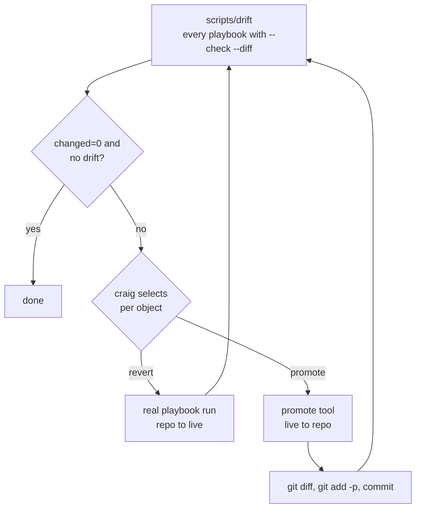

# Drift

Drift is a difference between the repo and the live state. The live state wins by default.
A routine run does not revert manual changes. For each object that drifts, craig selects
one of two actions:

- **Revert:** apply the repo to the live state.
- **Promote:** copy the live state into the repo.

## Report

`scripts/drift [pattern]` runs every playbook with `--check --diff`, one host at a time. It
is read-only. A pattern selects runs, for example `scripts/drift docker3`.

The script writes one log per run and `summary-<HHMM>.md` to `_private/drift/<date>/`. The
summary shows two types of drift:

- **changed:** the number of tasks that a real run will change. Host roles and stacks show
  their drift here.
- **report:** the result of the drift report tasks. Objects in the Proxmox API (cluster
  config, HA, guests) show their drift here. A clean report prints `No drift: ...`.

The summary also shows the age of the newest CephFS backup on PBS. An age of more than 26
hours is an error.

Live objects in `/etc/pve` that are not in the repo show as unmanaged. The report does not
change them.

## Revert

| Object | Command |
| --- | --- |
| Host config (roles) and stacks | A real run of the host playbook |
| Cluster objects in `/etc/pve` | `playbooks/proxmox_cluster_config.yml -e proxmox_cluster_config_write=true -e '{"proxmox_cluster_config_only": ["storage:pbs"]}'` |
| Guests | Not possible. Guests are create-only, so the report only shows the drift. |

`proxmox_cluster_config.yml` changes one object at a time with `pvesh`. It does not delete
objects. `proxmox_cluster_config_only` limits the run to the objects in the list. Do not
set `proxmox_cluster_config_write` and `proxmox_cluster_config_capture` in the same run.

The safety rules in `AGENTS.md` apply to each revert:

1. Do a `--check --diff` run, one host at a time. Start with the canary (docker3, pve3).
2. Get craig's approval for the check run.
3. Do the real run.

## Promote

| Object | Command | Result |
| --- | --- | --- |
| A file that a role copies without change | `playbooks/promote.yml --limit <host> -e promote_dest=<live path> -e promote_src=roles/<role>/files/<file>` | The live file replaces the repo file |
| Cluster config | `playbooks/proxmox_cluster_config.yml -e proxmox_cluster_config_capture=true` | The live files replace the files in `roles/proxmox_cluster_config/files/` |
| A guest | `uv run scripts/promote-guest <vmid>` | The live `node` and `config` replace the guest in `guests.yml` |

A promote writes only to the repo. It does not change a host.

- `promote.yml` accepts only files under `roles/*/files`. Edit templates (`.j2`) by hand. A
  file that many hosts share changes all of these hosts.
- `promote-guest` keeps comments and other guests. It does not write the volatile keys
  (`proxmox_guests_volatile_keys`).

After each promote:

1. Read the result with `git diff`.
2. Keep the correct hunks with `git add -p`.
3. Commit.

## Finish

Run `scripts/drift` again. Make sure that the object shows `changed=0` and `no drift`.
